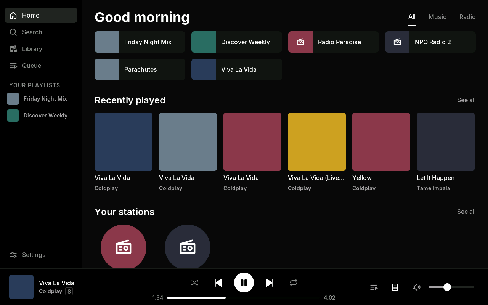
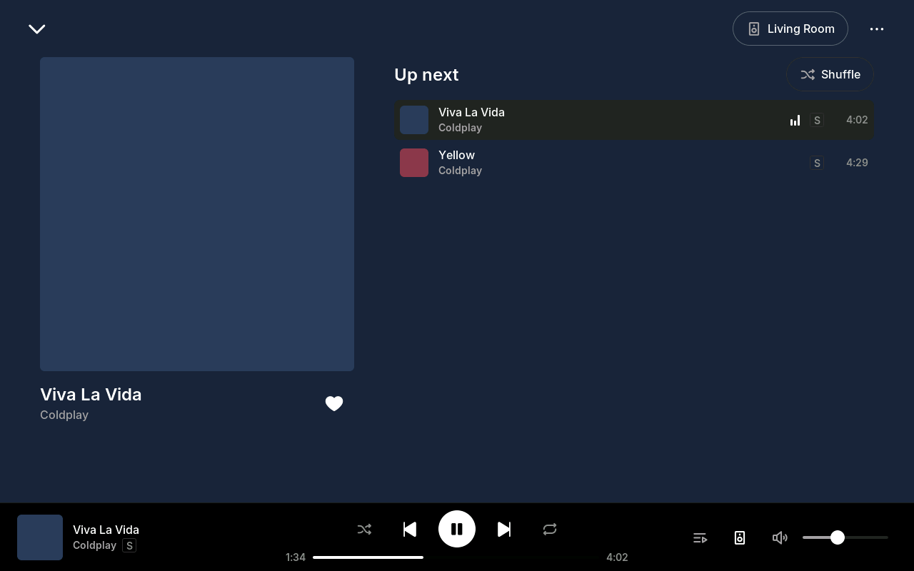
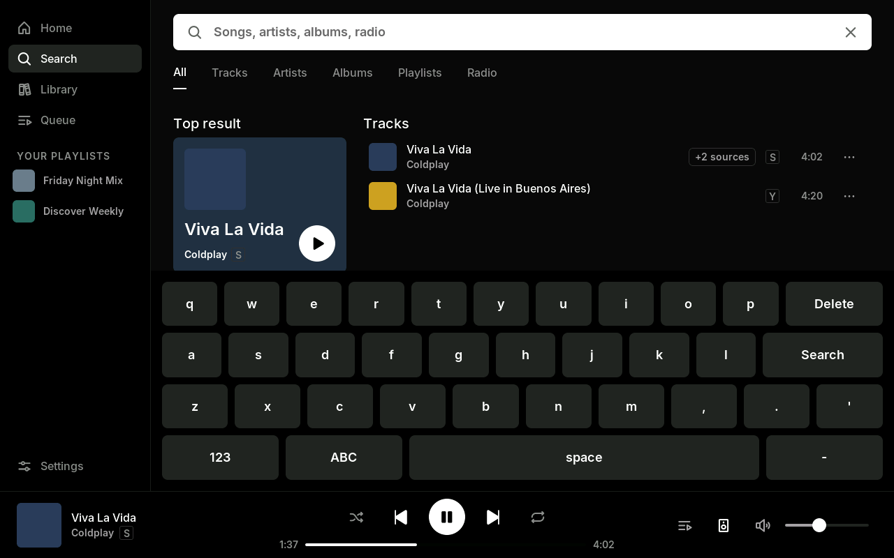
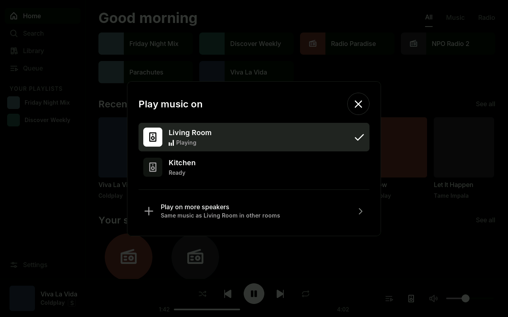
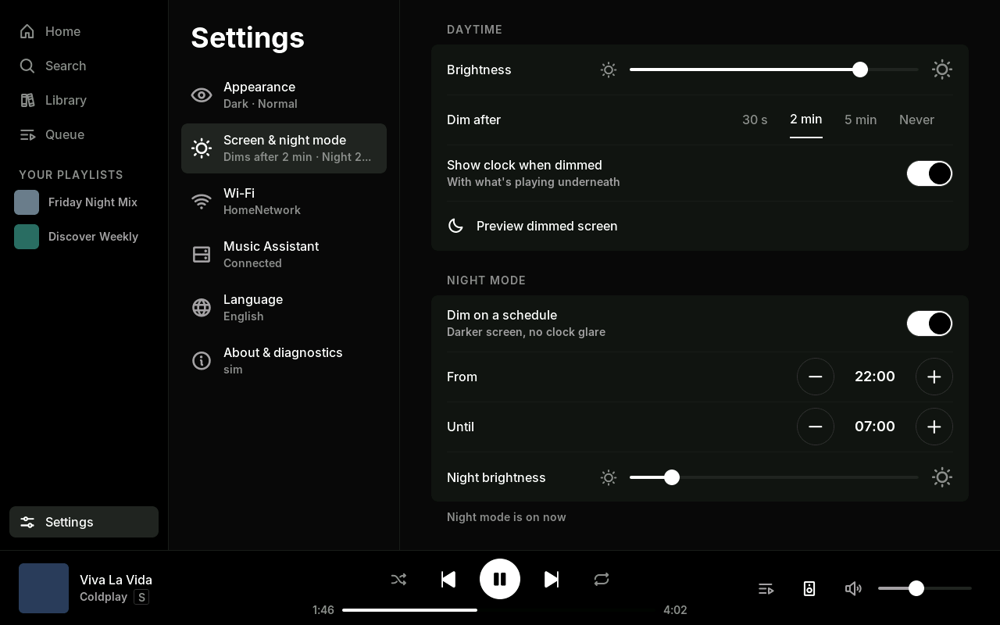

<h1 align="center">Music Assistant Interface</h1>

<p align="center">
  A touch wall panel for <a href="https://music-assistant.io">Music Assistant</a>, built for the Waveshare ESP32-P4 10.1" display.
</p>

<p align="center">
  
  
  
  <a href="https://github.com/simply-justin/music-assistant-interface/actions/workflows/ci.yml"></a>
  
  
</p>

<p align="center">
  
</p>

Music Assistant brings Spotify, YouTube Music, radio and your own files together and plays them on any speaker in the house. This project puts all of that on a screen on the wall, so anyone in the house can start the music with one tap, without unlocking a phone or opening an app.

> [!NOTE]
> The application is in active development. It runs in the PC simulator against a mock or a real Music Assistant server. The firmware, including board support, builds for the ESP32-P4 but has not run on the device yet; see [Roadmap](#roadmap).

## Features

- **One search across every source.** Your library answers instantly while streaming services are still searching, and a song that is on three services shows up once, not three times.
- **Any speaker, any group.** Choose the speaker from the player bar, group speakers and set the volume per speaker or for the whole group.
- **Full playback control.** Now Playing, a queue you can edit (play next, move, remove, undo) and playlist editing.
- **Made for the wall.** Touch targets of at least 56 px, so you hit them at arm's length. The screen dims to a clock when idle and follows a night schedule.
- **Guided setup.** Pick a Wi-Fi network and find the server, then sign in by scanning a QR code with your phone instead of typing a token.
- **Your look.** Light and dark modes, six accent colours, three corner styles and a reduced-motion setting.
- **Multilingual.** English and Dutch ship today. Adding a language takes one column in a CSV file and no code.

| Now Playing | Search |
|:---:|:---:|
|  |  |
| **Speaker picker** | **Settings** |
|  |  |

<sub>Rendered by the simulator with mock data; the coloured squares stand in for artwork.</sub>

## Quick start

Try the panel on your PC; no hardware is needed. You need Linux (or WSL2), CMake, a C++17 compiler, the X11 headers and ESP-IDF 5.5, whose cJSON library the PC build uses.

```sh
git clone https://github.com/simply-justin/music-assistant-interface.git && cd music-assistant-interface
export IDF_PATH=~/esp/v5.5.1/esp-idf
cmake -S test/sim -B test/sim/build && cmake --build test/sim/build -j
test/sim/build/music_panel_sim
```

The [Getting started](docs/getting-started.md) tutorial covers the prerequisites and how to connect the simulator to your own Music Assistant server.

## Requirements

| Component | Version |
|---|---|
| Display | Waveshare ESP32-P4 10.1" touch panel (1280 × 800), with an ESP32-C6 for Wi-Fi |
| Music Assistant | 2.x; verified against 2.10.13 (API schema 65) |
| Toolchain | ESP-IDF 5.5, CMake 3.16+, a C++17 compiler, Python 3 |

## Documentation

**Learn**
- [Getting started](docs/getting-started.md): build the simulator, connect it to your server and run the tests.

**How-to guides**
- [Testing](docs/testing.md): every way to run the panel without hardware, plus a manual test checklist.
- [Extending the panel](docs/extending.md): add a command, a feature, a screen, a string or a language.

**Reference**
- [Configuration](docs/configuration.md): command-line options, `server.env`, menuconfig and stored settings.
- [Design](docs/design.md): layout, design tokens, components and motion.

**Background**
- [Architecture](docs/architecture.md): layers, threading and data flow, and the Music Assistant protocol.
- [Accessibility](docs/accessibility.md): the WCAG 2.2 AA review.

## Roadmap

| Area | Status |
|---|---|
| Core: speakers, playback, queue, search, favourites, playlists, browse | Done |
| Every screen and overlay, light and dark themes, English and Dutch | Done |
| First-time setup flow (logic and screens) | Done |
| PC simulator, command-line test client | Done |
| Unit, integration and end-to-end tests, CI on every push | Done |
| Board support: display, touch, backlight, Wi-Fi via the ESP32-C6, server discovery, phone pairing page, hardware JPEG artwork | Built; not yet verified on the device |
| Over-the-air updates | Planned; two app slots reserved |

## Contributing

Contributions are welcome. Read [CONTRIBUTING.md](CONTRIBUTING.md) for the code style, how to run the tests and what a pull request needs.

## Acknowledgements

- [Music Assistant](https://music-assistant.io), the server this panel talks to.
- [LVGL](https://lvgl.io) for the graphics library.
- [Inter](https://rsms.me/inter/) by Rasmus Andersson and [Phosphor Icons](https://phosphoricons.com).

## License

Released under the [MIT License](LICENSE).
